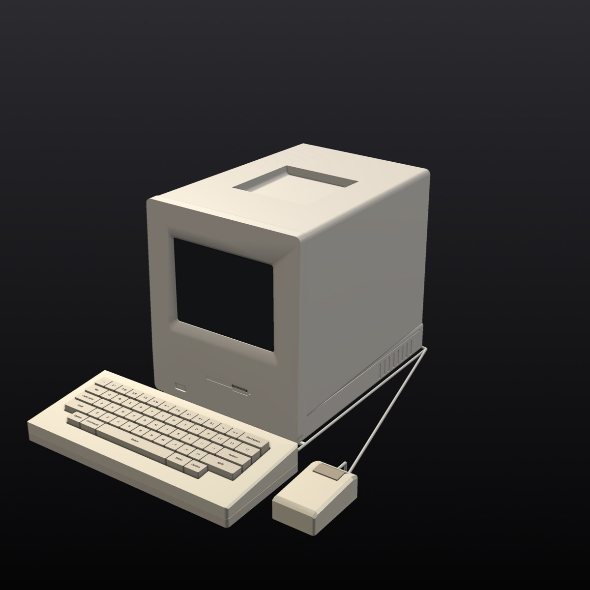
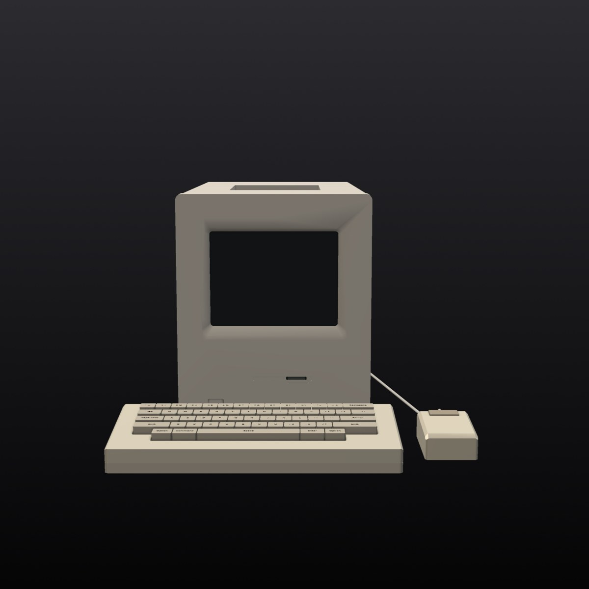
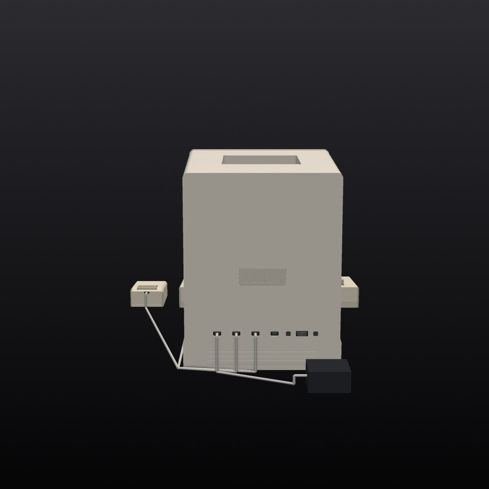
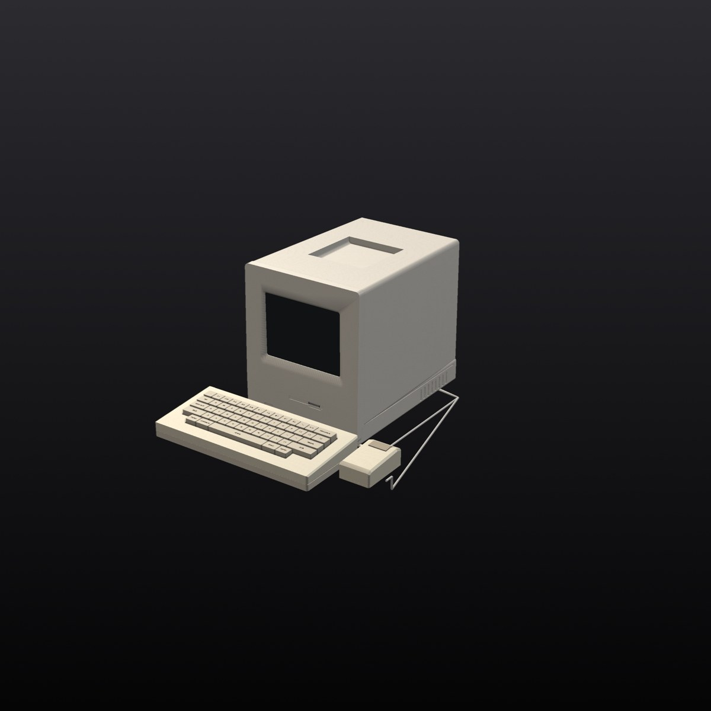
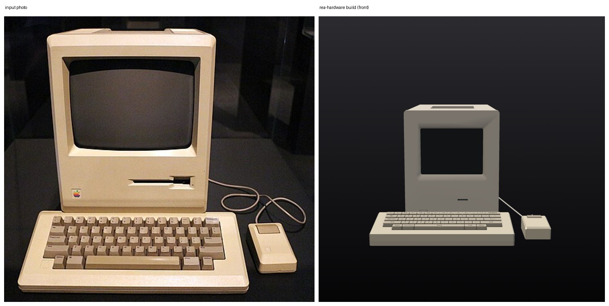
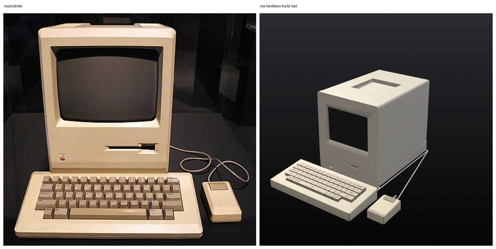
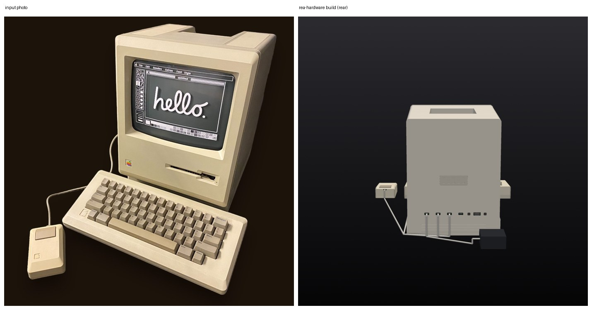

<p align="center"></p>

# CopperPilot Retro Desktop Computer

**A compact 1980s-style all-in-one desktop computer around a Raspberry Pi Compute Module 5, with an 8-inch 4:3 IPS screen, a front SD media slot and brightness wheel, a separate 58-key mechanical keyboard and a one-button optical mouse, all on USB-C. Designed end to end by CopperPilot from three photos and a two-line prompt.**

[](https://copperpilot.ai)  [](reviews/gates.md) [](reviews/kicad) [](reviews)  [](LICENSE)

> [!NOTE]
> **Designed by [CopperPilot](https://copperpilot.ai).** CopperPilot's agents designed every board, schematic, layout and enclosure part in this repo from one prompt and a few reference photos, then checked them with the gates and reviews below. Nobody edited the design files by hand. The whole prompt was two lines ("Build a compact all-in-one desktop computer like the one in these photos, with its keyboard and mouse. It should boot a full desktop OS, so use a Raspberry Pi Compute Module 5 as the brain."); the agents split it into three modules, chose the parts, drew and routed every board, modelled the cases and fixed every review finding themselves. **It has not been fabricated, assembled or powered on yet.** Everything here is open for review: if you see something a senior engineer would flag, [open an issue](../../issues/new/choose).

Three separately built modules on one desk, joined by USB-C cables:
- **Desktop** (247 x 300 x 346 mm): a 4-layer carrier board for the Compute Module 5 against the rear panel and a
  small front I/O board behind the bezel with the SD card socket and the brightness wheel's encoder, joined by a
  flat cable. The 8-inch 4:3 IPS panel (1024x768, MIPI DSI) sits in the recessed front bezel.
- **Keyboard** (338 x 148 x 48 mm): 58 MX-style mechanical switches in a diode matrix, read by an RP2040, on one
  2-layer board; sculpted keycaps in a stepped two-part case.
- **Mouse** (62 x 97 x 37 mm): one wide primary button, an optical motion sensor (PMW3901) read by an STM32F042,
  on one 2-layer board.

## Status

### Done

- [x] Schematic: KiCad ERC, 0 errors
- [x] Layout: KiCad DRC with schematic parity and zone refill, 0 errors, 0 unconnected
- [x] Board rules no looser than the fab's limits, nothing silenced
- [x] Every part on the footprint and 3D model of its exact LCSC part
- [x] Every placed part has a live, in-stock LCSC/JLCPCB part number
- [x] High-speed groups (USB, MIPI, DDR where present) routed, length-matched, on target impedance
- [x] Every user-facing connector opens towards its case opening (checked on its 3D model)
- [x] Every connector mates from a known side, with a keep-clear zone KiCad DRC enforces
- [x] Both ends of every board-to-board cable carry the same signal on each wire
- [x] Datasheet-level design review: 0 P0 and 0 P1 findings open on every board
- [x] Enclosure parts are closed solids that fit the product envelope
- [x] Every enclosure part is manufacturable by its process (wall thickness, build size)
- [x] Full assembly with the real PCBAs: no collisions, seated or along any insertion path
- [x] Every cable joins two real connectors and fits its route in every pose
- [x] Every connector faces what mates with it; every screw hole sits on a boss
- [x] Every port opening has its connector right behind it
- [x] Every button and control physically reaches the switch it works
- [x] Every camera's whole field of view clears the case
- [x] Every part is held by something real (screw, snap, clip, adhesive, press fit)
- [x] Gerbers, drill, BOM and CPL exist and agree with the PCB
- [x] System: every module passes, the modules' cables plug into real ports, and the power tree adds up
- [x] Independent judge (compares renders to the reference photos): **8/10** ([notes](reviews/judge.md))

### Pending

- [ ] Compact all-in-one CM5 desktop computer, gate `sourcing.bom` warn: 50 extended parts (each adds a JLCPCB feeder fee); prefer basic parts where equivalent
- [ ] Compact all-in-one CM5 desktop computer, gate `kicad.drc` warn: [main] DRC warning silk_overlap x199
- [ ] Compact all-in-one CM5 desktop computer, gate `board.contract` warn: [main] J_BL rotation 180.0 != spec 0.0
- [ ] Compact all-in-one CM5 desktop computer, gate `board.pd_autonomous` warn: both a host-driven PD controller ['U_CC_MOUSE', 'U_CC_KB'] and a standalone sink ['U_PD']: make sure the standalone one owns the charging port's CC lines at power-up
- [ ] Compact 58-key mechanical desktop keyboard, gate `kicad.drc` warn: DRC warning lib_footprint_mismatch x9
- [ ] Single-button rectangular optical USB mouse, gate `kicad.drc` warn: DRC warning silk_overlap x142
- [ ] **Not built.** No board has been fabricated or assembled and no case has been printed.
- [ ] **No software bring-up.** The CM5 device tree for the panel, the backlight and brightness wheel, the keyboard's RP2040 firmware and the mouse's STM32 firmware are not written or tested.
- [ ] **Bought parts are specified from drawings.** The 8-inch MIPI DSI panel and the USB-C PD adapter are modelled from typical drawings; exact supplier parts still have to be chosen and checked against those models.
- [ ] **Display size:** the bezel window is sized for the 8-inch panel (162.6 x 122.0 mm active area), smaller than the 9-inch window of the reference.
- [ ] **Judge notes (8/10):** the front I/O board sits flat behind the media slot, so the slot frames a shallow recess rather than a deep drive bay; an extra 20 x 10 mm recess is cut into the bezel above the chin.
- [ ] **Thermal design not analysed.** No thermal simulation of the CM5 inside the closed case.

0 P0 · 0 P1 · 1 P2 review findings open; the full reviews with evidence and suggested fixes are in [reviews/](reviews). Every P0 and P1 the reviews raised was fixed before release.

## Build film

[docs/build-film.mp4](docs/build-film.mp4) (155 s, 1080p). Every part backs out along the direction it was fitted and goes back in assembly order, and every cable is drawn along its real route. Every frame is replayed against the 3D models (no part passes through another, the camera stays outside, the product stays in frame and faces you, no flicker), and a separate critic watches the film ([notes](reviews/film.md)).

## Renders

| | |
|:---:|:---:|
| <br>*Three-quarter view* | <br>*Front* |
| <br>*Rear* | <br>*Exploded* |

## What's inside

**Power path (desktop):** external 65 W USB-C PD adapter → CH224A PD sink (asks for 15 V) → SY8205 5 V / 5 A buck for
the CM5 and peripherals, TLV62569 3.3 V buck, TPS61165 LED driver for the panel backlight with PWM dimming from the
brightness wheel. Keyboard and mouse ports each have a current-limited 5 V switch (TPS2041B).
**Display:** 8-inch 4:3 IPS module over 4-lane MIPI DSI from the CM5, with its own switched 3.3 V supply.

| Board | Size | Layers | Parts | Tracks | Vias | KiCad project | Review |
|---|---|---|---|---|---|---|---|
| Compact all-in-one CM5 desktop computer: main board | 180 × 245 mm | 4 | 147 | 3,305 | 303 | [`modules/desktop/hardware/compact-cm5-desktop.kicad_pro`](modules/desktop/hardware/compact-cm5-desktop.kicad_pro) | [0 P0 · 0 P1](reviews/review-desktop-main.md) |
| Compact all-in-one CM5 desktop computer: front SD card and brightness encoder sub-board | 150 × 65 mm | 2 | 84 | 838 | 113 | [`modules/desktop/hardware/front_io/compact-cm5-desktop-front_io.kicad_pro`](modules/desktop/hardware/front_io/compact-cm5-desktop-front_io.kicad_pro) | [0 P0 · 0 P1](reviews/review-desktop-front_io.md) |
| Compact 58-key mechanical desktop keyboard: main board | 310 × 132 mm | 2 | 156 | 1,068 | 73 | [`modules/keyboard/hardware/compact-58key-keyboard.kicad_pro`](modules/keyboard/hardware/compact-58key-keyboard.kicad_pro) | [0 P0 · 0 P1](reviews/review-keyboard-main.md) |
| Single-button rectangular optical USB mouse: main board | 52 × 86 mm | 2 | 55 | 368 | 46 | [`modules/mouse/hardware/mouse.kicad_pro`](modules/mouse/hardware/mouse.kicad_pro) | [0 P0 · 0 P1](reviews/review-mouse-main.md) |

**Bought parts** (modelled from their drawings; the assembly checks use these models):

- **Cm5 module**: Raspberry Pi Compute Module 5 (BCM2712 quad-core Cortex-A76, 8GB LPDDR4X, 32GB eMMC, onboard Wi-Fi/BLE antenna)
- **Lcd panel**: 8.0-inch 4:3 IPS TFT LCD display module

## How it was made

CopperPilot's agents worked from the prompt in [reference/prompt.md](reference/prompt.md) and 3 reference photos ([reference/](reference)). The pipeline scopes the product into a written contract ([design/spec.yaml](design/spec.yaml)), designs the boards and the enclosure in parallel, integrates them, and only moves on when the gates pass. A separate review agent reads every board against the part datasheets, and a separate judge compares the result with the photos.

- Pipeline wall clock: about **27 h** over 5 launches (pipeline v99 to v113).

**Reference vs build:**





<sub>Reference photos of a commercial product, used here only for comparison. All rights belong to their owners; this project is not affiliated with or endorsed by the product's maker.</sub>

## Repository layout

```
modules/<id>/      one folder per module, each with the layout below
  hardware/        KiCad 10 projects, with every symbol, footprint and 3D model
  case/out/        enclosure parts (STL); case/purchased/ bought parts used in the assembly checks
  fab/             Gerbers, drill, BOM, CPL, schematic PDF and STEP; fab/mech/ enclosure STEP/STL
  design/spec.yaml the module's design contract
design/system.yaml how the modules connect: interfaces, power tree, cables
reviews/           gate reports, design reviews, the judge's notes, KiCad ERC/DRC
reference/         the prompt and the reference photos
docs/              build film and renders
```

## Manufacture

Every board targets **JLCPCB** standard PCB + assembly (1.6 mm FR-4); every part has an LCSC number. Per board: upload `*-gerbers.zip`, then `*-bom.csv` and `*-cpl.csv` for assembly, and check the part rotations in JLCPCB's preview before ordering.

The desktop and keyboard cases are designed for MJF-printed PA12 nylon (with a PMMA display window), the mouse for
FDM; STEP files for each part are in each module's `fab/mech/`, with STLs for test prints. Boards are set up for
JLCPCB fabrication and assembly (Gerbers, BOM and CPL per board).

> [!WARNING]
> This design has not been built yet. Fix or accept the open review findings above before you order boards, and expect a first revision to need changes.

## Review this design

Hardware gets better with more eyes on it. We'd like to hear what you'd flag:

- **Open an issue** ([design review template](../../issues/new/choose)) for a wrong pin, a missing part, a tight clearance, a part you'd swap, or a P1 above you disagree with.
- **Send a pull request** with a fix. Say which board and which reference designators it touches.
- **Build one** and tell us how it went: photos, bring-up notes and failures are all welcome.

Start with [reviews/](reviews): every finding has its evidence and a suggested fix.

## License

[CERN-OHL-S-2.0](LICENSE). You may use, study, modify, make and sell products from this design; modified versions must be shared under the same licence.

Bought-part names and the Raspberry Pi Compute Module are named only to say what fits; all trademarks belong to their owners.

<p align="center"><a href="https://copperpilot.ai"><b>Designed by CopperPilot</b></a>: we accelerate hardware design.<br><sub>More open designs: <a href="https://github.com/CopperPilot">github.com/CopperPilot</a></sub></p>
